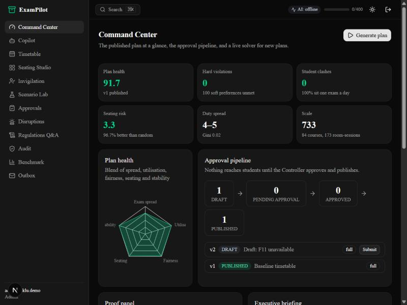

# ExamPilot

An agentic examination planner. It builds a clash-free timetable, allocates rooms, assigns invigilators and produces seat-level plans that keep students of the same course apart. An administrator can change the plan in plain language, typed or spoken; every constraint is re-validated, conflicts are explained with ranked alternatives, and nothing is published without explicit approval. Every reasoning step, tool call and decision is in a tamper-evident audit log.

**All data is synthetic** (Faker). No real system is ever contacted; email and WhatsApp are mock outbox rows.



## Quick start

Requirements: Python 3.11 or newer, Node 20 or newer, and GNU make (or run the commands in the Makefile by hand).

```bash
./run.sh            # setup + seed + dev in one go
```

or step by step:

```bash
make setup          # virtualenv, pip install, npm install
make seed           # synthetic data + baseline plan (published) + one draft, a few seconds
make dev            # API on :8000, web on :3000
```

Open http://localhost:3000 and pick an account on the login page (password `Demo@1234` for all):

| Role | Email |
| --- | --- |
| Administrator (Controller) | `admin@jklu.demo` (also `admin2@jklu.demo`) |
| Faculty | `faculty01@jklu.demo` … `faculty45@jklu.demo` |
| Student | `student001@jklu.demo` … `student733@jklu.demo` |

Other commands: `make test` (pytest and `tsc --noEmit`), `make demo`, `make reset-demo` (restores the demo state in a few seconds), `make openapi` (exports `docs/openapi.json` and regenerates `frontend/lib/api-types.ts`), `SCALE=3 make seed` (about 2,200 students).

No Gemini key is needed. Without one the badge shows **AI: offline** and a deterministic parser handles requests through the same tools, validator and audit trail. To enable Gemini copy `backend/.env.example` to `backend/.env`, set `GEMINI_API_KEY`, then run `python scripts/check_gemini.py` and paste the suggested model names. The badge turns **AI: live**.

## What to try

Follow [docs/DEMO_SCRIPT.md](docs/DEMO_SCRIPT.md). In short: generate a plan with the live solver, read the proof panel, ask the Copilot to `move CSE301 to 2026-12-07 afternoon`, try an impossible request, ask a policy question, compare scenarios, approve and publish, open the student view and the QR link, verify the audit chain, run the tamper demo.

## Layout

```
backend/app/engine    pure planning code: timetable, venues, invigilation, seating, independent validator
backend/app/agent     tools (role-checked), orchestrator, regulations RAG, Gemini adapter, offline parser
backend/app/services  lifecycle and approvals, audit chain, jobs, exports
backend/app/api       FastAPI routers
backend/app/config    rules.yaml: every rule parameter and objective weight
data/regulations.md   the only source for policy answers
frontend              Next.js app: admin, faculty, student and public verify pages
docs                  architecture, agent, decisions, rubric map, demo script, security, deploy
scripts               check_gemini, demo_flow, tamper_demo, export_openapi, smoke_deployed
```

## Documentation

[Architecture](docs/ARCHITECTURE.md) · [Agent](docs/AGENT.md) · [Decisions](docs/DECISIONS.md) · [Rubric map](docs/RUBRIC_MAP.md) · [Demo script](docs/DEMO_SCRIPT.md) · [Security](docs/SECURITY.md) · [Deploy](docs/DEPLOY.md) · [Build report](BUILD_REPORT.md)

## Tests

```bash
make test
```

The backend suite covers the planning engine (16 corruption mutations, planted conflict diagnosis, minimal disruption), the lifecycle and RBAC, tamper detection, the agent (ten scripted prompts, injection, tool roles, fallback), grounded regulation answers (15 cited, 8 refused) and exports.
